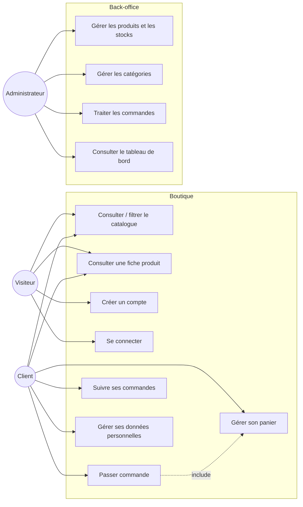
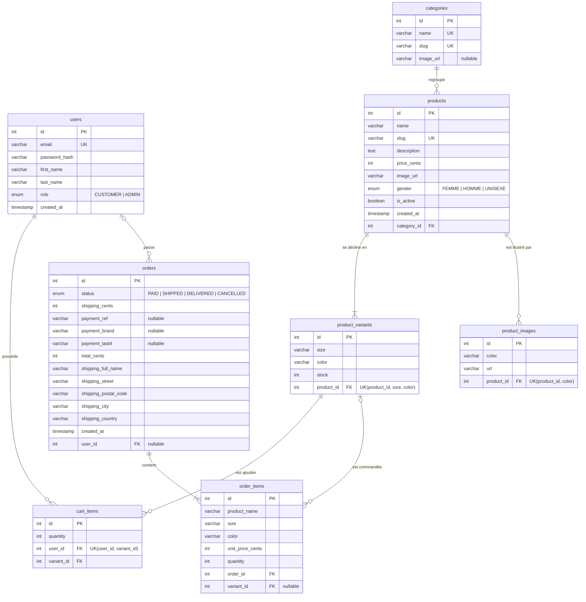
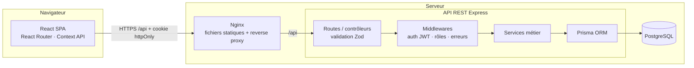
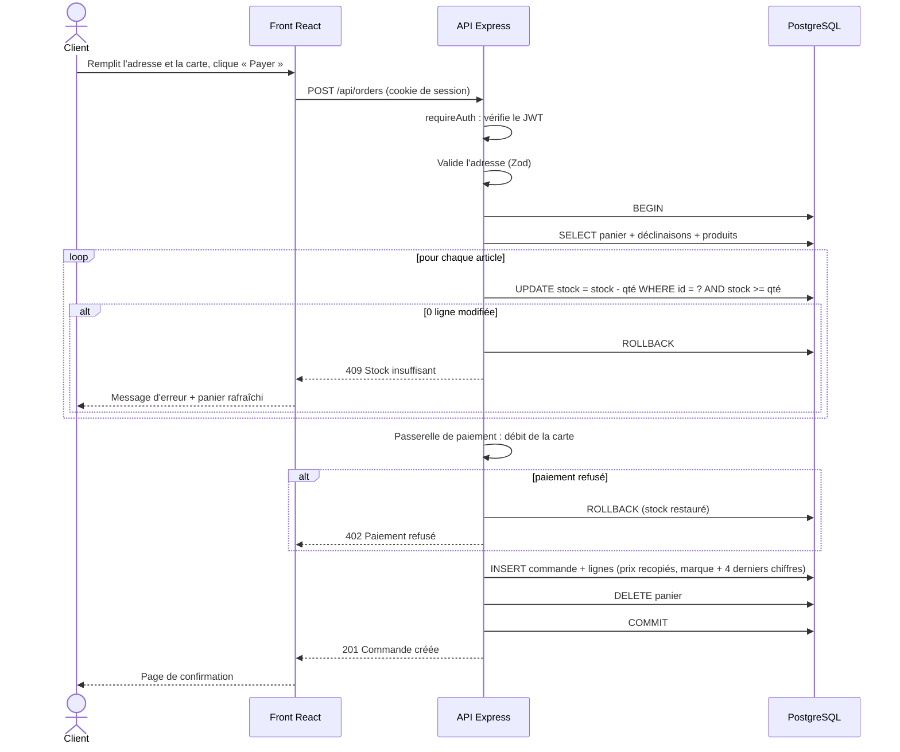
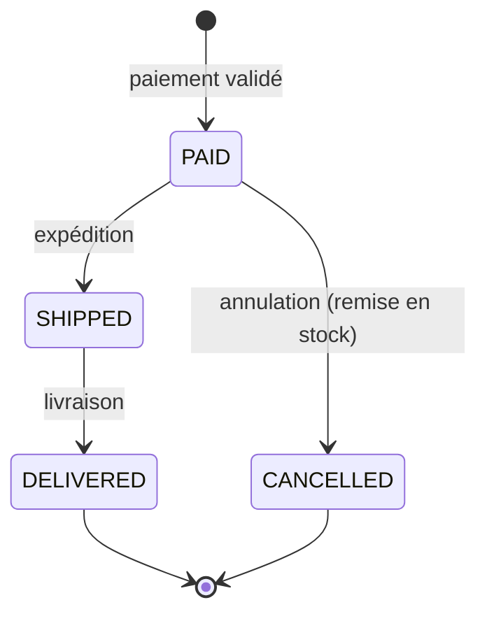

# 2. Conception

Les diagrammes sont écrits en [Mermaid](https://mermaid.js.org/) : ils s'affichent directement sur GitHub
et dans VS Code (extension *Markdown Preview Mermaid Support*).

## 2.1 Diagramme de cas d'utilisation



Le client hérite des cas d'utilisation du visiteur (catalogue) ; l'administrateur est un utilisateur authentifié
avec le rôle `ADMIN`.

## 2.2 Modèle conceptuel de données (MCD : Merise)

```
UTILISATEUR (id, email, mot_de_passe_hash, prénom, nom, rôle, date_création)
CATÉGORIE (id, nom, slug)
PRODUIT (id, nom, slug, description, prix, image, genre, actif, date_création)
DÉCLINAISON (id, taille, couleur, stock)
PHOTO (id, couleur, url)
COMMANDE (id, statut, frais_livraison, total, adresse_livraison…, date)
LIGNE_COMMANDE (id, nom_produit, taille, couleur, prix_unitaire, quantité)

APPARTENIR       : PRODUIT (1,1) --- (0,n) CATÉGORIE
DÉCLINER         : DÉCLINAISON (1,1) --- (1,n) PRODUIT
ILLUSTRER        : PHOTO (1,1) --- (0,n) PRODUIT   [une photo par couleur]
METTRE_AU_PANIER : UTILISATEUR (0,n) --- (0,n) DÉCLINAISON   [quantité]
PASSER           : COMMANDE (0,1) --- (0,n) UTILISATEUR
CONTENIR         : LIGNE_COMMANDE (1,1) --- (1,n) COMMANDE
CONCERNER        : LIGNE_COMMANDE (0,1) --- (0,n) DÉCLINAISON
```

Remarques sur le MCD :

- **METTRE_AU_PANIER** est une association porteuse (quantité) entre UTILISATEUR et DÉCLINAISON : elle devient la
  table `cart_items` avec une contrainte d'unicité (user_id, variant_id).
- **PASSER** est en (0,1) côté commande : une commande survit à la suppression du compte (RGPD + comptabilité).
- **LIGNE_COMMANDE** recopie nom, taille, couleur et prix (dénormalisation volontaire, RG05) ; le lien vers la
  déclinaison est facultatif (0,1) pour la même raison.

## 2.3 Modèle logique / physique (MLD)



Choix techniques :

- **Montants en centimes (entiers)** : aucun arrondi flottant (0,1 + 0,2 ≠ 0,3).
- **Règles de suppression** (`ON DELETE`) : `CASCADE` pour les déclinaisons d'un produit et le panier d'un client,
  `SET NULL` pour les commandes d'un compte supprimé, `RESTRICT` pour une catégorie encore utilisée.
- **Index** sur les clés étrangères les plus filtrées (`products.category_id`, `orders.user_id`).

Le script SQL généré est versionné dans
[backend/prisma/migrations](../backend/prisma/migrations) et appliqué par `prisma migrate deploy`.

## 2.4 Architecture logicielle



**Architecture en couches** côté API, chaque module (`auth`, `products`, `cart`, `orders`…) étant découpé en :

| Couche | Fichier | Responsabilité |
|---|---|---|
| Présentation (contrôleur) | `*.routes.ts` | Routes HTTP, lecture de la requête, code de réponse |
| Validation | `*.schemas.ts` | Schémas Zod : types, formats, bornes |
| Métier | `*.service.ts` | Règles de gestion, transactions |
| Accès aux données | Prisma (`lib/prisma.ts`) | Requêtes SQL paramétrées, mapping objet-relationnel |

Le front-end est une **SPA** : les pages appellent un client d'API unique (`src/api/client.ts`) ; l'état global
(utilisateur connecté, panier) est partagé via deux contextes React.

## 2.5 Diagramme de séquence : passer commande



Le décrément conditionnel (`WHERE stock >= qté`) empêche la **survente** même si deux clients valident en même temps
le dernier exemplaire : la base garantit qu'un seul des deux `UPDATE` réussit.

## 2.6 Diagramme d'états : commande



## 2.7 Maquettes

Les maquettes (zoning puis maquettes haute fidélité, version mobile et desktop) sont à réaliser sur Figma pour les
écrans : accueil, catalogue, fiche produit, panier, tunnel de commande, espace client, back-office produits.
Ajouter les exports dans `docs/maquettes/`.

**Charte graphique** : fond crème `#f6f3ee`, texte et accent bleu nuit `#1f2a37` (contraste 13,1:1, conforme AAA ; texte secondaire `#5d6673` à 5,2:1, conforme AA),
titres en serif (Georgia), texte en police système sans-serif.
