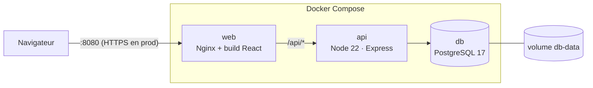
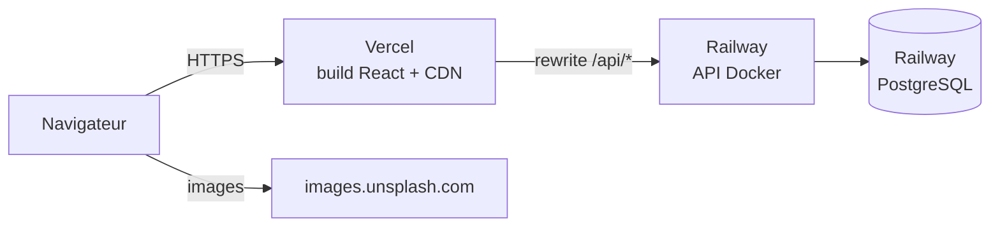

# 5. Déploiement

## 5.1 Environnements

| Environnement | Composition | Base de données |
|---|---|---|
| Développement | `docker compose up -d db` + API (`npm run dev`, port 3000) + Vite (port 5180) | `boutique` sur `localhost:55432` |
| Test | Lancé par `npm test` et par la CI | `boutique_test` (même serveur en local, service PostgreSQL en CI) |
| Production (simulée) | `docker compose up -d --build` : PostgreSQL + API + Nginx | volume Docker `db-data` |

## 5.2 Architecture de déploiement



- Le conteneur **web** sert les fichiers statiques du build Vite et relaie `/api` vers le conteneur **api**
  (même origine → cookie `SameSite=Strict`).
- Le conteneur **api** applique automatiquement les migrations en attente (`prisma migrate deploy`) au démarrage,
  puis lance le serveur. Il s'exécute avec un utilisateur non root.
- Seul le port de Nginx est exposé publiquement ; la base n'est exposée (port 55432) que pour le développement.

## 5.3 Procédure de mise en production

```bash
# 1. Variables d'environnement (secret jamais versionné)
cp .env.example .env
# éditer .env et définir JWT_SECRET (48 octets aléatoires) :
node -e "console.log(require('crypto').randomBytes(48).toString('hex'))"

# 2. Construction et démarrage
docker compose up -d --build

# 3. (première installation uniquement) données de démonstration
#    ⚠ le seed vide les tables avant de les remplir : ne jamais le lancer sur des données réelles
docker compose exec api npx prisma db seed

# 4. Vérification
curl http://localhost:8080/api/health   # {"status":"ok"}
```

Mise à jour : `git pull && docker compose up -d --build` (les nouvelles migrations sont appliquées au démarrage
de l'API).

Sauvegarde de la base :

```bash
docker compose exec db pg_dump -U boutique boutique > sauvegarde-$(date +%F).sql
```

## 5.4 Intégration continue (GitHub Actions)

Le fichier [.github/workflows/ci.yml](../.github/workflows/ci.yml) s'exécute à chaque push et pull request :

1. **backend** : installation, génération du client Prisma, vérification des types, tests unitaires et
   d'intégration sur un service PostgreSQL, `npm audit`.
2. **frontend** : installation, tests de composants, build de production.
3. **docker** : construction des deux images (seulement si les deux jobs précédents réussissent).

Une pull request ne peut être fusionnée sur `main` que si la CI est verte (règle de protection de branche à activer
sur GitHub).

## 5.5 Hébergement en ligne : Railway (API + base) et Vercel (front)



Vercel **relaie** les appels `/api/*` vers Railway (règle `rewrites` de
[frontend/vercel.json](../frontend/vercel.json)). Pour le navigateur, le front et l'API ont donc la même origine :
le cookie de session `SameSite=Strict` fonctionne sans CORS ni cookie tiers.

### Étape 1 : API et base sur Railway

```bash
cd backend
railway login
railway init                      # crée le projet « maison-lune »
railway add --database postgres   # ajoute PostgreSQL
railway add --service api         # service de l'API
railway up --service api          # build du Dockerfile et déploiement
```

Dans le tableau de bord Railway, service **api** → *Variables* :

| Variable | Valeur |
|---|---|
| `DATABASE_URL` | `${{Postgres.DATABASE_URL}}` (référence vers la base) |
| `JWT_SECRET` | 48 octets aléatoires (`node -e "console.log(require('crypto').randomBytes(48).toString('hex'))"`) |
| `NODE_ENV` | `production` |
| `TRUST_PROXY` | `2` (Vercel puis le proxy Railway) |
| `CLIENT_URL` | l'URL Vercel (étape 2) |

Puis *Settings → Networking → Generate Domain* pour obtenir l'URL publique (`https://xxx.up.railway.app`).
Le fichier [backend/railway.json](../backend/railway.json) configure le build Docker et la sonde de santé
`/api/health`. Les migrations sont appliquées automatiquement à chaque démarrage.

Données de démonstration (une seule fois, ⚠ vide les tables) :

```bash
railway ssh --service api -- npx prisma db seed
```

### Étape 2 : Front sur Vercel

1. Remplacer `REMPLACER-PAR-URL-RAILWAY` dans [frontend/vercel.json](../frontend/vercel.json) par le domaine Railway.
2. Déployer :

```bash
cd frontend
vercel login
vercel --prod     # Root directory = frontend (Vite détecté)
```

Ou depuis l'interface Vercel : *Add New → Project*, importer le dépôt GitHub, *Root Directory* = `frontend`.
Chaque push sur `main` redéploie alors automatiquement (déploiement continu).

3. Reporter l'URL Vercel dans la variable `CLIENT_URL` de Railway.

### Vérification

```bash
curl https://<projet>.vercel.app/api/health   # {"status":"ok"} : la réécriture vers Railway fonctionne
```

## 5.6 Pistes d'amélioration

- Hébergement sur un VPS avec un reverse proxy TLS (Caddy ou Traefik + Let's Encrypt) devant le conteneur web.
- Publication des images sur un registre (GHCR) depuis la CI, puis déploiement continu (CD).
- Base managée avec sauvegardes automatiques ; secrets gérés par le fournisseur.
- Supervision : endpoint `/api/health`, logs centralisés.
